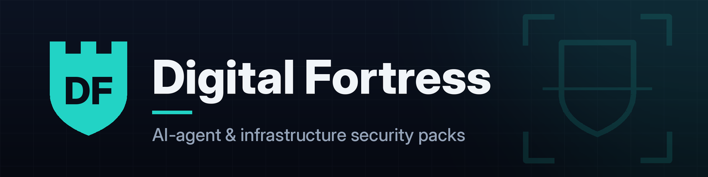

  
  
  

**Digital Fortress** builds practical security and governance kits for teams that ship AI agents: checklists, prompts, and templates you can use the same day. Start with the free tools below. Go deeper with the paid packs.

## 🛠️ Free tools

<table>
<tr>
<td width="50%" valign="top">
<h3><a href="https://github.com/digitalfortressaudit/agent-guardrails-baseline">agent-guardrails-baseline</a></h3>

A 15-minute baseline: 25 checks across identity, egress, tool authorization, sandbox, and logging.

</td>
<td width="50%" valign="top">
<h3><a href="https://github.com/digitalfortressaudit/ai-security-starter-checklist">ai-security-starter-checklist</a></h3>

Five copy-paste LLM audit prompts plus a read-only Python repo scanner.

</td>
</tr>
<tr>
<td width="50%" valign="top">
<h3><a href="https://github.com/digitalfortressaudit/ai-system-agent-inventory-register">ai-system-agent-inventory-register</a></h3>

AI system and agent inventory (CSV and Excel) with NIST AI RMF, ISO 42001, and EU AI Act fields.

</td>
<td width="50%" valign="top">
<h3><a href="https://github.com/digitalfortressaudit/mcp-tool-pin-check">mcp-tool-pin-check</a></h3>

Pins MCP tool definitions and flags drift or tool poisoning between listings.

</td>
</tr>
</table>

## 🛡️ Paid packs

| Pack | Price |
|---|---|
| [AI Agent Governance & Adverse-Decision Compliance Kit](https://fortressaudit.gumroad.com/l/ai-agent-governance-adverse-decision-kit) | $799 |
| [Multi-Agent Orchestration Blueprint](https://fortressaudit.gumroad.com/l/cvxfw) | $149 |
| [Agent Runtime Containment Pack](https://fortressaudit.gumroad.com/l/ngouvf) | $99 |
| [AI Security & Infrastructure Prompt Pack](https://fortressaudit.gumroad.com/l/myyeen) | $99 |
| [MCP & Multi-Agent Authorization Security Pack](https://fortressaudit.gumroad.com/l/wphmlq) | $79 |

<a href="https://fortressaudit.gumroad.com"><b>Browse the full store →</b></a>

---

© 2026 Digital Fortress · Security tooling for the agent era · <a href="https://fortressaudit.gumroad.com">fortressaudit.gumroad.com</a>

